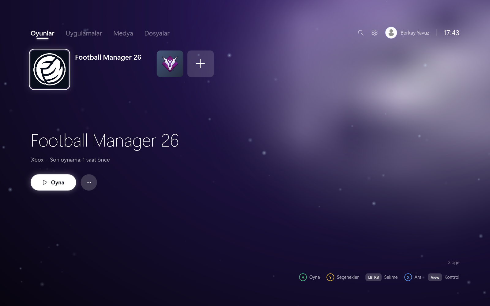
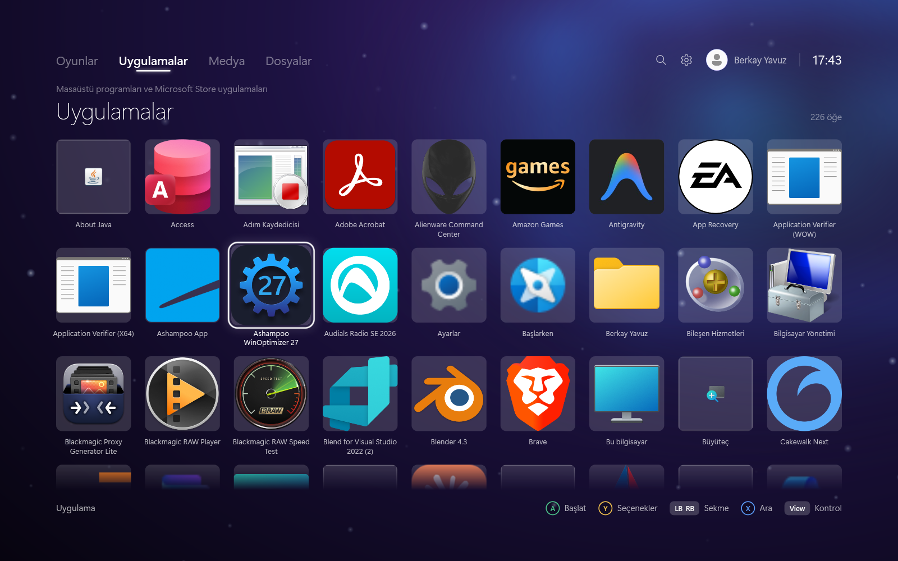
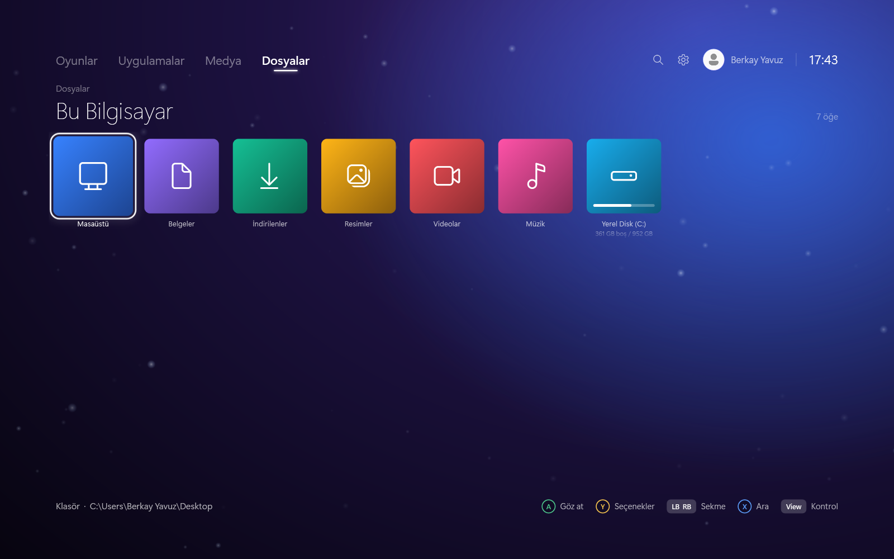
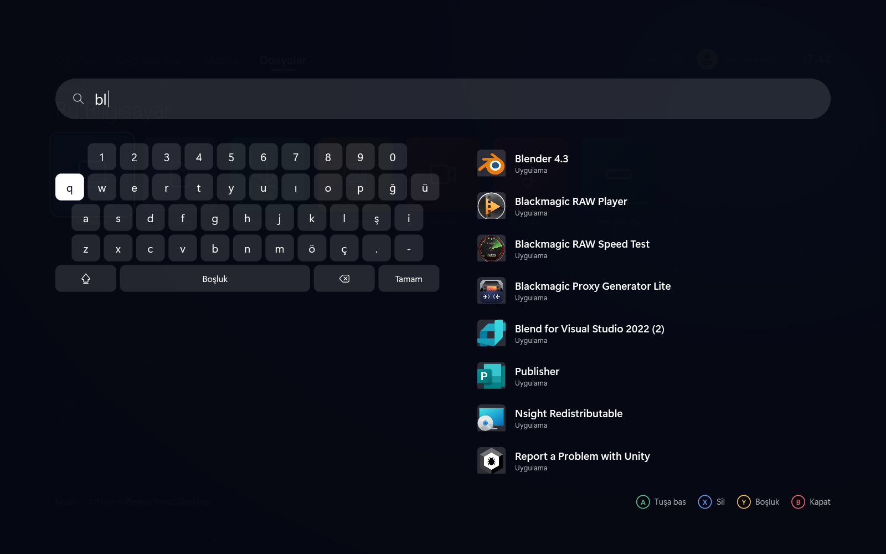
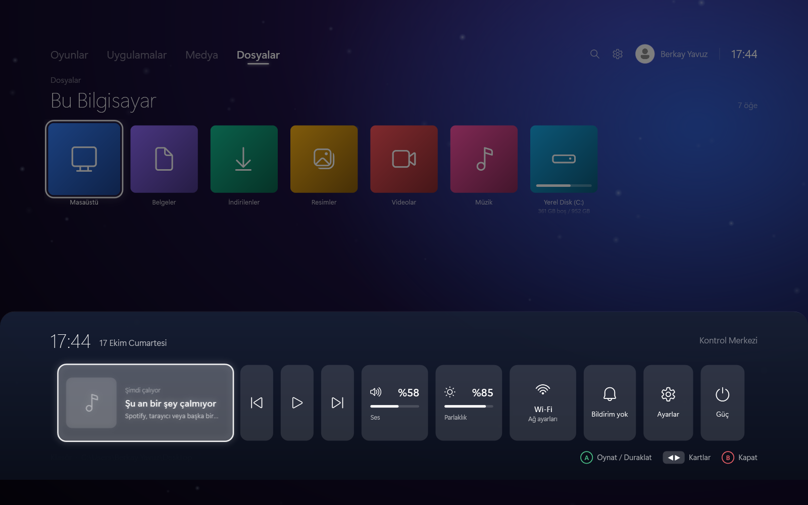
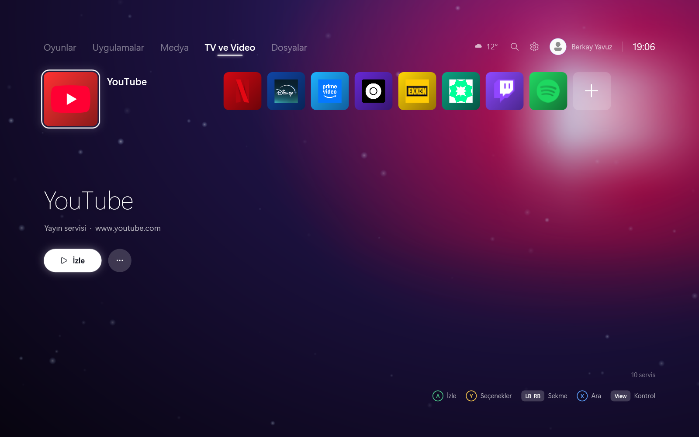
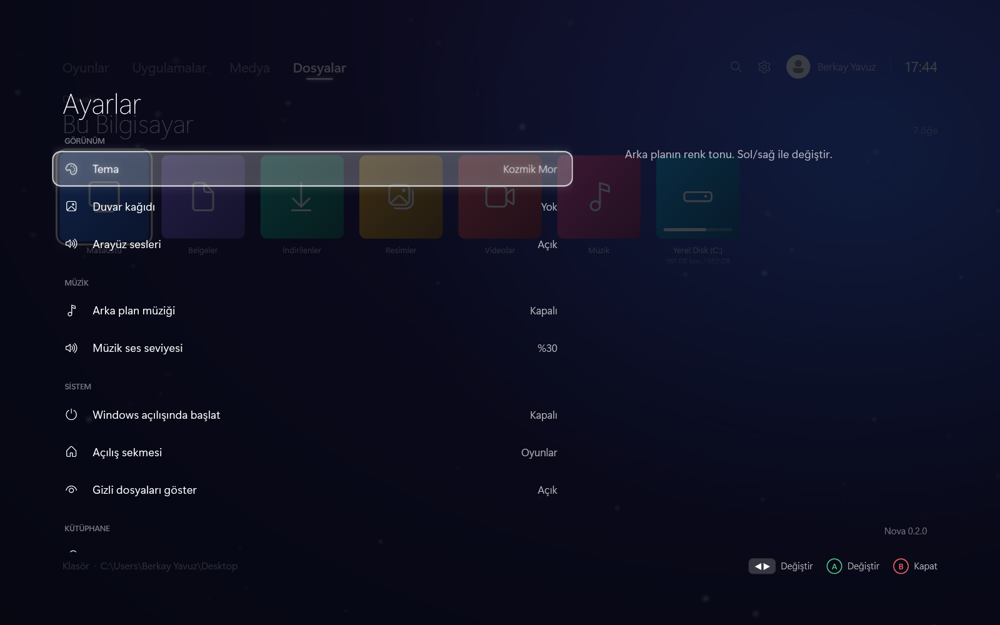

# Nova

English | [Türkçe](README.md)

**A console-style, fullscreen home screen for Windows.** Reach your games, apps, media and files
from the couch with a gamepad; keyboard, mouse and your phone work everywhere too.
*Available in English and Turkish.*



## Download

[**Download the latest release**](../../releases/latest) → unzip it and run `Nova.exe`. Optionally,
**Settings › Install Nova on this PC** adds shortcuts to the Start menu and desktop; Nova then
downloads and installs future versions by itself.

- Windows 10 (1809 or later) or Windows 11, 64-bit
- The release page offers two options: a standalone exe for PCs without .NET, and a smaller exe for
  PCs with the .NET 9 Desktop Runtime installed.

## Features

| | |
|---|---|
|  |  |
|  |  |
|  |  |

*Screenshots show the Turkish interface; switch to English under Settings › Language.*

**Library and media**
- **Games:** Automatically finds games from Steam, Epic Games, GOG, Xbox / Game Pass, Ubisoft Connect, EA app and Battle.net; games can also be added manually. The most recently played game comes first. Steam games show cover art, a fullscreen background, logo, playtime, **latest news** and **download / update progress**.
- **Apps:** Desktop programs and Microsoft Store apps.
- **TV & Video:** YouTube, Netflix, Disney+, Prime Video, HBO Max, Exxen, tabii, Twitch, Spotify and your own sites open in fullscreen app mode.
- **Media:** Photo viewer, video and music player, PDF and text preview; separate folders for screenshots and clips.
- **File browser:** Thumbnail grid; copy / cut / paste, rename, recycle bin, new folder, sorting; USB drive notifications.

**Console experience**
- **Background mode:** When closed, Nova waits in the notification area next to the clock and opens instantly with the gamepad or a hotkey. It can start hidden when Windows starts.
- **Open even when closed:** After Nova is closed, a windowless listener of about 9 MB stays in the background; Ctrl+Alt+N or the gamepad combo reopens Nova. Choosing "Quit completely" from the tray icon closes it too.
- **In-game quick menu:** While playing, **Start + View** on the gamepad (or Ctrl+Alt+G) opens a panel over the game: back to Nova, screenshot, record the last 30 seconds (Xbox Game Bar), volume, close game; shows session and daily playtime.
- **Screenshots:** Ctrl+Alt+S anywhere; saved to Pictures › Nova.
- **Trophies:** Nova's own trophies (bronze, silver, gold, platinum) and optional Steam achievements.
- **Control Center:** Now playing with controls, volume, brightness, network, battery, CPU / memory / GPU usage and temperature, calendar, weather, sleep timer, phone remote, notifications.
- **Search:** Across games, apps and all files; on-screen keyboard for typing with a gamepad.
- **Weather** in the top bar (Open-Meteo; automatic location or by city name).

**Ease of use**
- **Phone remote:** D-pad, A/B/X/Y and quick typing from the browser of a phone on the same Wi-Fi; PIN protected.
- **Multiple users:** A "Who's playing?" screen; everyone has their own pins, playtime, trophies and settings.
- **Daily play time limit** and **sleep timer** (sleep or shut down).
- **Personalization:** Color themes, wallpaper, background music, pinning to the home screen.
- **Installer and auto-update**, **English / Turkish** interface.


## Controls

| Action | Keyboard | Xbox controller | PlayStation controller |
|---|---|---|---|
| Navigate | Arrow keys | D-pad / left stick | D-pad / left stick |
| Select / Launch | Enter, Space | A | Cross |
| Back | Esc, Backspace | B | Circle |
| Options | O | Y | Triangle |
| Search | S, Ctrl+F | X | Square |
| Control Center | C | View | PS / Create / touchpad |
| Power menu | P | Start | Options |
| Switch tab | Q / E, Tab, 1–5 | LB / RB | L1 / R1 |
| Page jump | PgUp / PgDn | LT / RT | L2 / R2 |
| **Back to Nova / Open Nova** (even when closed) | **Ctrl + Alt + N** | **Start + View** | **Options + Create** |
| **In-game menu** | **Ctrl + Alt + G** | **Start + View** (in game) | **Options + Create** |
| **Screenshot** | **Ctrl + Alt + S** | From the in-game menu | From the in-game menu |
| Window / fullscreen | F11 | — | — |

Xbox and XInput-compatible controllers are supported through XInput, and DualShock 4 and DualSense
through Windows.Gaming.Input, with no extra software required.

The in-game menu appears over windowed and borderless fullscreen games; it may not appear in some
games running in exclusive fullscreen. "Record the last 30 seconds" requires background recording
to be enabled in Xbox Game Bar.

## Building from source

Requires the [.NET 9 SDK](https://dotnet.microsoft.com/download/dotnet/9.0).

```bash
dotnet run --project Nova.csproj
```

Single-file exe:

```bash
dotnet publish Nova.csproj -c Release -r win-x64 --self-contained true -p:PublishSingleFile=true -p:IncludeNativeLibrariesForSelfExtract=true -p:EnableCompressionInSingleFile=true -p:DebugType=none -o publish-standalone
```

The app icon is generated with `tools/make-icon.ps1`.

Settings are stored in `%AppData%\Nova\settings.json` (`settings_<id>.json` for additional users),
the user list in `profiles.json`, downloaded artwork in `art\`, and error logs in `error.log`.

### Technical notes

- C# / .NET 9, WPF; the UI is designed on a 1920x1080 canvas and scales to any resolution
- Thumbnails and icons: Windows Shell `IShellItemImageFactory` (COM)
- Volume: Core Audio `IAudioEndpointVolume`; brightness and GPU usage: WMI; `nvidia-smi` on NVIDIA
- Gamepad: XInput and `Windows.Gaming.Input.RawGameController`
- File search: Windows Search index (OLE DB)
- Now playing, network info and PDF preview: WinRT APIs
- Phone remote: a small HTTP server on the local network (port 8642, protected by PIN and cookie)
- Localization: UI strings are translated from a lookup table as they appear on screen
- UI sounds are not loaded from files; they are generated from waveforms synthesized at startup

### Test mode

If the `NOVA_SCRIPT` environment variable is set, the app plays back the given action sequence by
itself and saves screenshots to the `NOVA_SHOTS` folder:

```
NOVA_SCRIPT="wait:3500 Search type:steam wait:2000 shot:arama quit"
```

## License

[MIT](LICENSE)
